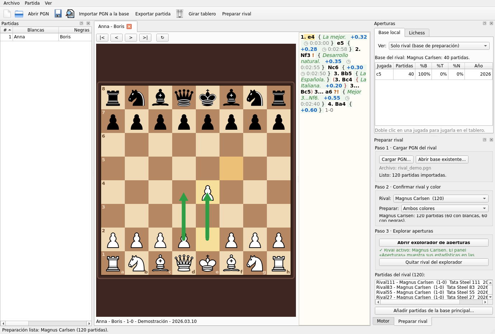

# ChessStudio — Chess Game Manager

> Gestiona tu colección PGN, prepara rivales y analiza posiciones con tus propios motores UCI desde una aplicación de escritorio libre.

[](LICENSE)
[](https://github.com/mkllnd1517/Chess-Game-Manager/actions/workflows/tests.yml)
[](pyproject.toml)

ChessStudio reúne en un único entorno local las tareas habituales de estudio:
abrir e indexar colecciones PGN, explorar repertorios, preparar a un rival,
editar variantes y analizar posiciones. Tus bases, partidas y motores siguen
bajo tu control; no se incluye ni se descarga ningún motor de ajedrez.

<p align="center">
  
</p>

## Lo más importante

- **PGN bien conservado:** importa, abre, busca, edita y exporta partidas con
  comentarios, variantes, NAG, evaluaciones, relojes, flechas `%cal` y casillas
  `%csl`.
- **Tablero pensado para estudiar:** dibuja anotaciones con clic derecho,
  navega con el teclado y crea o continúa variantes directamente al mover una
  pieza.
- **Preparación de rivales:** crea una base de referencia desde un PGN y estudia
  el repertorio por color, o compáralo con tu propia base.
- **Explorador de aperturas:** consulta estadísticas locales o las bases de
  Lichess, con filtros de ritmo y Elo.
- **Motores UCI propios:** análisis continuo, MultiPV y posición fijada. Elige
  el ejecutable UCI que hayas obtenido legalmente; ChessStudio no distribuye
  Stockfish ni ningún otro motor.
- **Fluida con archivos grandes:** las importaciones y aperturas se procesan en
  segundo plano, se pueden cancelar y la notación larga se renderiza de forma
  progresiva.
- **Privacidad y seguridad:** token de Lichess en el llavero del sistema cuando
  está disponible, peticiones HTTPS restringidas a Lichess y PGN externo tratado
  como contenido no confiable.

## Instalar y abrir desde el escritorio

### Opción recomendada para usuarios de Windows

En una publicación oficial, descarga `ChessStudio-Setup-<versión>.exe` desde
[**Releases**](https://github.com/mkllnd1517/Chess-Game-Manager/releases),
ejecútalo y marca **«Crear un acceso directo en el escritorio»**.
Después podrás abrir ChessStudio desde el escritorio o el menú Inicio: no hay
que instalar Python ni ejecutar `main.py`. El instalador también asocia los
archivos `.pgn`, de modo que podrás abrir una partida con doble clic.

> El repositorio contiene una receta reproducible para generar ese instalador;
> consulta [Crear un instalable](#crear-un-instalable). Publica únicamente
> binarios generados y verificados desde una etiqueta de este repositorio.

### Instalar desde Python

Necesitas Python 3.10 o posterior y un escritorio compatible con Qt.

```bash
git clone https://github.com/mkllnd1517/Chess-Game-Manager.git
cd Chess-Game-Manager
python -m pip install --upgrade pip
python -m pip install .
chessstudio
```

El comando `chessstudio` es un lanzador gráfico instalado por el paquete. El
archivo `main.py` permanece solo como lanzador de compatibilidad para clones
antiguos; no forma parte del flujo normal de uso.

En Linux, una instalación `pip` también puede añadirse al menú de aplicaciones
con [`packaging/linux/io.github.mkllnd1517.ChessStudio.desktop`](packaging/linux/io.github.mkllnd1517.ChessStudio.desktop).
Si usas la carpeta creada por PyInstaller, sigue las instrucciones de
[`packaging/linux/README.md`](packaging/linux/README.md).

### Crear un instalable

La compilación produce una aplicación autocontenida y no incorpora un motor
UCI. Hazla en el sistema operativo de destino:

```bash
python -m pip install -e ".[test,build]"
python scripts/build_release.py
```

- **Windows:** el script crea `dist/ChessStudio/`. Si [Inno Setup 6](https://jrsoftware.org/isinfo.php)
  está en `PATH`, también genera `dist/installer/ChessStudio-Setup-0.6.0.exe`
  con asistente de instalación, desinstalador y acceso directo de escritorio
  opcional. Si no está instalado, el script muestra el comando `ISCC` exacto.
- **Linux:** distribuye completa la carpeta `dist/ChessStudio/` y registra el
  archivo `.desktop` indicado arriba.

Antes de publicar el binario, sigue la [lista de verificación de distribución](THIRD_PARTY_NOTICES.md#5-lista-de-verificación-para-una-publicación-pública), especialmente los avisos de Qt/PySide6.

## Primeros pasos

1. Abre ChessStudio: se crea una base local predeterminada en la carpeta de
   documentos del sistema, `ChessStudio/default.csdb`.
2. Usa **Importar PGN a la base...** para incorporar una colección o **Abrir
   PGN...** para estudiar una partida sin importarla.
3. Haz doble clic en una partida. El tablero, la notación y los paneles de
   aperturas/motor se sincronizan al navegar.
4. Guarda los cambios con `Ctrl+S` o exporta una partida PGN independiente.

La ventana se organiza en tres zonas: lista de partidas a la izquierda,
tablero y notación en el centro, y aperturas, motor y preparación a la derecha.
Los paneles se muestran desde **Ver** y se pueden reorganizar.

### Navegación y variantes

| Atajo | Acción |
|---|---|
| `←` / `→` | Posición anterior / siguiente |
| `↑` / `↓` | Cambiar opción en el selector de variantes |
| `→` o `Enter` en el selector | Confirmar la variante seleccionada |
| `Inicio` / `Fin` | Primera / última posición de la línea principal |
| `Ctrl+S` | Guardar la partida en la base |
| `Ctrl+F` | Buscar partidas |
| `Ctrl+Shift+O` | Abrir un PGN |
| `F` | Girar el tablero |

Al llegar a una posición con varias continuaciones, la primera pulsación de
`→` abre el selector. Elige con `↑`/`↓` y pulsa de nuevo `→` para continuar:
puedes recorrer una partida sin apartar la mano del teclado.

### Flechas, marcas y texto de PGN

| Acción sobre el tablero | Resultado |
|---|---|
| Arrastrar con botón derecho | Flecha verde |
| Clic derecho | Marca una casilla verde |
| `Shift` + acción | Rojo |
| `Alt` + acción | Azul |
| `Shift` + `Alt` + acción | Amarillo |

Las flechas y marcas procedentes de Lichess, Chess.com u otros PGN compatibles
se reconocen al abrir el archivo. Se vinculan al nodo PGN concreto, por lo que
las variantes que alcanzan el mismo tablero mantienen anotaciones distintas.
Las flechas tienen contraste y una opacidad que permite leer tanto la dirección
como las piezas del tablero.

La notación separa visualmente línea principal, variantes, comentarios,
evaluaciones y relojes; los códigos técnicos `[%cal]`, `[%csl]`, `[%eval]` y
`[%clk]` no ensucian el texto de lectura.

## Preparar un rival y analizar

### Preparación de rival

1. Abre **Preparar rival** y pulsa **Cargar PGN...**.
2. Confirma el jugador detectado y elige partidas con blancas, negras o ambos
   colores.
3. Abre el explorador. El modo **Solo rival** utiliza su base como referencia;
   también puedes comparar ambos repertorios.

Las bases de preparación se guardan en `Documentos/ChessStudio/prep/` (o la
carpeta equivalente del sistema) y no se suben a ningún servicio.

### Explorador y Lichess

El panel **Aperturas** puede usar estadísticas de las bases locales o el
explorador de Lichess. Para este último, crea un token personal **sin permisos**
en <https://lichess.org/account/oauth/token>. Sin token el resto de la
aplicación funciona normalmente. Consulta los [términos de Lichess](https://lichess.org/terms-of-service).

### Motor UCI

Selecciona en el panel **Motor** el ejecutable de un motor UCI que hayas
instalado. Puedes mostrar de una a cinco líneas (MultiPV), fijar una posición
mientras exploras la partida y reanudar después el seguimiento automático.

**Importante:** Stockfish, sus binarios y sus fuentes no están incluidos en
este repositorio ni en el instalador. Revisa la licencia del motor que decidas
usar.

## Seguridad y datos

- `keyring` guarda el token de Lichess en Windows Credential Locker, macOS
  Keychain o Secret Service cuando están disponibles; hay un mecanismo local
  alternativo para sistemas sin llavero.
- El token solo se entrega mediante HTTPS a `lichess.org` y `lichess.ovh`; las
  redirecciones no se siguen automáticamente.
- Comentarios y cabeceras de PGN se escapan antes de mostrarse. El visor bloquea
  la carga de recursos externos/locales y las consultas SQLite usan parámetros.
- No añadas al repositorio bases privadas, PGN personales, tokens, claves o
  motores UCI.

## Desarrollo

```bash
python -m pip install -e ".[test]"
QT_QPA_PLATFORM=offscreen python -m pytest
```

La integración continua ejecuta las pruebas y compila los módulos en Python
3.10 y 3.11. Consulta [`CONTRIBUTING.md`](CONTRIBUTING.md) para el flujo de
cambios, y [`SECURITY.md`](SECURITY.md) para informar una vulnerabilidad de
forma responsable.

```text
Chess-Game-Manager/
├── chessstudio/              # Aplicación, piezas SVG, icono y punto de entrada
├── packaging/                # PyInstaller, Inno Setup y acceso directo Linux
├── scripts/build_release.py  # Construcción del paquete de escritorio
├── tests/                    # Pruebas automatizadas
├── LICENSE                   # GPL-3.0-or-later
├── NOTICE                    # Copyright, garantía y atribuciones resumidas
├── THIRD_PARTY_NOTICES.md    # Inventario y lista de publicación
└── pyproject.toml            # Metadatos, dependencias y comando chessstudio
```

## Licencia y atribuciones

ChessStudio se distribuye bajo **GNU GPL v3.0 o posterior**
([`LICENSE`](LICENSE)). El código propio se acompaña de [`NOTICE`](NOTICE).
Las piezas cburnett son obra de Colin M. L. Burnett y se redistribuyen bajo
GPL-2.0-or-later con sus avisos intactos. `python-chess`, Qt/PySide6, `keyring`
y las herramientas de empaquetado conservan sus propias condiciones.

Revisa [`THIRD_PARTY_NOTICES.md`](THIRD_PARTY_NOTICES.md) antes de redistribuir,
en especial si publicas un instalador. La información es una guía de
cumplimiento, no asesoramiento jurídico.

## Contribuir

Las mejoras y los informes de errores son bienvenidos. Antes de abrir una
propuesta, ejecuta las pruebas, documenta cualquier dependencia o recurso nuevo
en los avisos de terceros y no incluyas información personal o binarios de
motores. Al contribuir, aceptas licenciar tu aportación bajo GPL-3.0-or-later.
